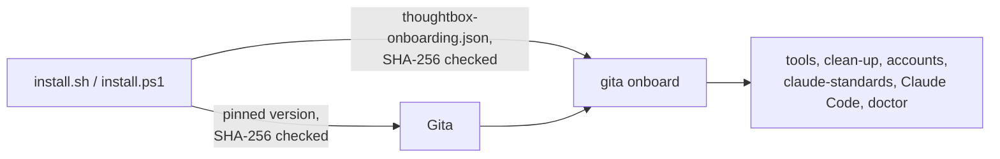

# dev-setup

One command to set up a ThoughtBox developer machine.

**Windows** (PowerShell):
```powershell
irm https://raw.githubusercontent.com/ThoughtBoxFinTechAI/dev-setup/main/install.ps1 | iex
```

**macOS / Linux:**
```bash
curl -fsSL https://raw.githubusercontent.com/ThoughtBoxFinTechAI/dev-setup/main/install.sh | bash
```

You'll be asked for your name, your **@thoughtbox.io** email and your **@thoughtbox.one**
email, and you'll sign in to GitHub twice: once per account. The rest is automatic. Run
it again any time: every step checks what is already there, keeps what works, and
repairs what is broken.

Macs need Apple silicon (M1 or later): the Gita command isn't built for Intel Macs yet.
Linux needs x86_64. Windows needs Windows 10 or later.

## How it works

The script installs [Gita](https://github.com/naseebnaushad/gita) (an open-source app,
not made by ThoughtBox) and hands over to it:



1. **The script** checks the computer, then installs the Gita version pinned at the top of
   the script, after checking its SHA-256. An older Gita is updated, one that doesn't run
   is reinstalled, and a newer one is kept. The app goes to `%LOCALAPPDATA%\Programs\Gita`,
   `~/Applications/gita.app` or `~/.local/share/gita`; the `gita` command to
   `~/.gita/bin` (added to PATH). Profiles and settings in `~/.gita` are kept.
2. **The script** downloads [`thoughtbox-onboarding.json`](thoughtbox-onboarding.json) from
   this repo, checks it against the SHA-256 pinned in the script, and runs
   `gita onboard` with it.
3. **Gita** does the rest ([what `gita onboard` does](https://github.com/naseebnaushad/gita/blob/master/docs/onboarding.md)):

| Step | Details |
|---|---|
| Tools | Git, GitHub CLI (optional) and Claude Code: installed if missing, reinstalled if they don't run. Windows: winget. macOS: Xcode tools + Homebrew. Linux: apt, dnf or pacman with sudo (also `secret-tool`, where Gita keeps sign-ins). |
| Clean-up | Old GitHub sign-ins that make git or gh use the wrong account: saved github.com logins (Windows Credential Manager, macOS Keychain, `~/.git-credentials`), `url.*.insteadOf` rules and sign-in headers for github.com, old credential helpers, GitHub CLI logins. Listed, then removed after you say yes, with a backup of `~/.gitconfig`. Gita's sign-ins, other sites and SSH keys are not touched. |
| Accounts | Gita profiles `ThoughtBox` (@thoughtbox.io) and `ThoughtBox AI` (@thoughtbox.one), each signed in to GitHub. Existing profiles with those emails are reused; an existing sign-in is kept after you confirm the account. |
| claude-standards | Cloned to `~/claude-standards` with the AI account (an existing clean copy is updated, one with local changes is kept, anything else is moved to `~/claude-standards.backup-<date>`), its Gita company files imported (`thoughtboxhub` → .io, `ThoughtBoxFinTechAI` → .one), then its setup run (rules, deny rules, company plugin). |
| Finish | Gita is connected to Claude Code and `gita doctor` checks everything. A summary shows every step. |
| Figma (optional) | After `gita onboard`, only if you answer **yes** to "Set up Figma for frontend work?" (default no). See [Figma for frontend developers](#figma-for-frontend-developers-optional). |

After it finishes: open a new terminal, run `claude` and sign in with your company seat.
For the GitHub CLI use `gita gh <command>` (for example `gita gh pr list`): it runs `gh` as
the right account for each project.

## How it all fits together

Diagrams of the whole lifecycle (setup flow, what goes where, sign-in and organization
approval, Gita version pinning, branches and releases, CI, troubleshooting) are in
[documents/Lifecycle and process flows.md](documents/Lifecycle%20and%20process%20flows.md).

## Figma for frontend developers (optional)

Figma's own API and MCP give free accounts only a few requests a month. The
[Figma MCP Bridge](https://github.com/gethopp/figma-mcp-bridge) avoids that: a Figma plugin
sends the open file to a small server on your own machine, and Claude Code reads and edits
the file through it. Everyone runs their own bridge and opens the **same shared Figma
file**, so edits from each person's Claude show up for everyone, live.

Answer **yes** when the setup asks, or run it with `TB_FIGMA=1`. Windows and macOS only:
the plugin needs the Figma desktop app, which doesn't exist for Linux.

| What | Details |
|---|---|
| Node.js | Installed if missing or older than 20 (Windows: winget `OpenJS.NodeJS.LTS`; macOS: Homebrew `node`). |
| Figma desktop app | Installed if missing (Windows: winget `Figma.Figma`; macOS: Homebrew `--cask figma`). If that fails you get a link and the rest carries on. |
| Bridge server and plugin | A pinned version, checked against a SHA-512 (npm package) and a SHA-256 (plugin zip) in the script, installed to `~/.thoughtbox/figma-mcp-bridge` (`server/`, `plugin/`). |
| Claude Code | Adds the MCP server `figma-bridge` for your user (all projects), with `run_script` turned on (see below). |

If this step fails, you see why and the rest of the setup still finishes. Fix it and run
the setup again with `TB_FIGMA=1`.

**Once, by hand** (Figma has no way to script this):

1. Open the Figma desktop app (not the browser).
2. **Plugins → Development → Import plugin from manifest…** and pick
   `~/.thoughtbox/figma-mcp-bridge/plugin/manifest.json`
   (Windows: `%USERPROFILE%\.thoughtbox\figma-mcp-bridge\plugin\manifest.json`).

**Every time you work on a design:** open the shared file, run **Plugins → Development →
Figma MCP Bridge** (it shows "WebSocket Connected"), then start `claude`. To edit, you need
**can edit** access to the file; viewers can't run the plugin.

Working together on one file:
- Agree who works on which page or section. Two people's Claude editing the same frame at
  the same time overwrite each other.
- Don't use imported or duplicated copies (`.fig` exports, "Duplicate to your drafts") to
  work together: a copy is a separate file and won't stay in sync.
- The bridge only listens on `localhost:1994`, and the plugin only connects there, so it
  can't be shared over the network. Each person runs their own.

**`run_script` is on.** It lets Claude run any Figma Plugin API code in the file you have
open, with your edit rights, so it can make larger changes in one go. To turn it off:
```bash
claude mcp remove figma-bridge -s user
claude mcp add figma-bridge -s user -- "<path to node>" "$HOME/.thoughtbox/figma-mcp-bridge/server/node_modules/@gethopp/figma-mcp-bridge/dist/index.js"
```
(`claude mcp get figma-bridge` shows the node path in use.) Running the setup with
`TB_FIGMA=1` again turns it back on.

Known issue: `npm audit` reports a high-severity advisory in `zod` 3.x, which the bridge
uses ([GHSA-mrhx-c7xc-m3w5](https://github.com/advisories/GHSA-mrhx-c7xc-m3w5): very large
inputs can use up memory). There's no fixed bridge release yet. The input only comes from
your own Claude and the plugin on your own machine, so the worst case is the bridge
crashing.

Troubleshooting:
- **Claude doesn't see the file:** check the plugin says "WebSocket Connected", and that
  only one AI tool is running the bridge (only one can use port 1994). Restart `claude`.
- **`figma-bridge` fails to start after a Node.js update:** the entry points to the exact
  `node` the setup found. Run the setup again with `TB_FIGMA=1`.
- **"The Figma bridge is running"** during an update: close Claude Code and any other AI
  tool using the bridge, then run the setup again.

## Options

Set these environment variables before running:

| Variable | Effect |
|---|---|
| `TB_NAME`, `TB_EMAIL_IO`, `TB_EMAIL_ONE` | Answer the questions up front. |
| `TB_DRY_RUN=1` | Print what would change; change nothing. |
| `TB_CLEAN=1` | Remove old GitHub sign-ins without asking. Without a terminal and without this, nothing is removed. |
| `TB_LOG` | Where to write the log (default `~/.thoughtbox-setup.log`). |
| `TB_FIGMA=1`, `TB_FIGMA=0` | Set up Figma for frontend work, or skip it, without being asked. Unset: you're asked; with no terminal (CI, piped without one) it's skipped. |
| `TB_SKIP_SIGNIN=1`, `TB_SKIP_STANDARDS=1` | Skip GitHub sign-in, or claude-standards and its setup (for testing). |
| `TB_GITA_ZIP` (Windows), `TB_GITA_ARCHIVE` (macOS/Linux) | Install Gita from a local file instead of the release. No checksum check; for testing builds only. |
| `TB_ONBOARDING_FILE` | Use a local onboarding file instead of the one in this repo. No checksum check; for testing only. |

Windows example: `$env:TB_DRY_RUN='1'; irm .../install.ps1 | iex`.
macOS/Linux: `curl -fsSL .../install.sh | TB_DRY_RUN=1 bash`.

## When something goes wrong

- The setup stops with **"Setup stopped:"**, the reason and what to do. Fix that and run
  the same command again; finished steps are skipped.
- Every run writes a log to `~/.thoughtbox-setup.log`. Only you can read it, and no token is
  written to it. Send it when asking for help.
- **"claude-standards couldn't be downloaded"**: check these in order.
  1. **ThoughtBoxFinTechAI must approve the Gita app** (the most common cause). Signed in to
     github.com as your @thoughtbox.one account, open **Settings → Applications → Authorized
     OAuth Apps → Gita** and click **Request** next to ThoughtBoxFinTechAI. An org owner
     approves it under **Organization settings → Third-party access**. Then run the setup
     again.
  2. The `ThoughtBox AI` profile must be signed in as your @thoughtbox.one GitHub account.
     GitHub signs in whoever is logged in to github.com in your browser, so sign out there
     first (or use a private window), then run `gita sign-in --profile "ThoughtBox AI"` and
     the setup again.
  3. That account must be a member of ThoughtBoxFinTechAI. Ask an admin.
- **macOS `Killed: 9`**: run the setup again; it repairs Gita.
- If the clean-up signed out GitHub CLI, use `gita gh`, or run `gh auth login` with the
  right account for plain `gh`.
- Not changed automatically; check them yourself if git still uses the wrong account:
  `GH_TOKEN` / `GITHUB_TOKEN` set in your shell profile (or, on Windows, for all users),
  a `Host github.com` entry in your SSH settings (matters only for `git@github.com:`
  addresses), and other apps signed in to GitHub (your IDE, GitHub Desktop).

## For admins

### New Gita releases

The installers only install the exact Gita version and checksums pinned at the top of
each script. A workflow, **Update pinned Gita** (`.github/workflows/gita-bump.yml`), checks
every day (or when started by hand from the Actions tab) for a newer published Gita
release. When there is one, it checks every download against the release's `SHA256SUMS`,
starts the Linux build once, and opens a pull request that updates both scripts. It also
starts the installer tests on that branch. A person reviews and merges it.

It needs the repository setting **Allow GitHub Actions to create and approve pull
requests** (Settings → Actions → General). The same check can be run by hand:
`scripts/gita-bump.sh` (needs `gh`, signed in).

### Changing the onboarding steps

Edit `thoughtbox-onboarding.json` (format: [Gita's onboarding docs](https://github.com/naseebnaushad/gita/blob/master/docs/onboarding.md)),
then put its new SHA-256 in `ONBOARDING_SHA256` (`install.sh`) and `$OnboardingSha256`
(`install.ps1`) in the same pull request. CI fails if they don't match:

```bash
sha256sum thoughtbox-onboarding.json
```

## For admins: moving to a new Figma MCP Bridge version

The server (npm) and the plugin (GitHub release zip) are pinned together at the top of each
script. To move to release `X.Y.Z` of `gethopp/figma-mcp-bridge`:

1. Read its release notes, and check the licence is still MIT.
2. Get both checksums:
   ```bash
   mkdir /tmp/figma-bridge && cd /tmp/figma-bridge
   npm pack @gethopp/figma-mcp-bridge@X.Y.Z
   sha512sum gethopp-figma-mcp-bridge-X.Y.Z.tgz
   gh release download vX.Y.Z --repo gethopp/figma-mcp-bridge --pattern 'figma-mcp-bridge-vX.Y.Z.zip'
   sha256sum figma-mcp-bridge-vX.Y.Z.zip
   ```
   The zip's SHA-256 must match the digest GitHub shows on the release page.
3. Audit it: `npm install --prefix ./check ./gethopp-figma-mcp-bridge-X.Y.Z.tgz --ignore-scripts --omit=dev`
   then `npm audit --prefix ./check --omit=dev`.
4. Update `$FigmaVersion`, `$FigmaNpmSha512`, `$FigmaPluginSha256` in `install.ps1`, and
   `FIGMA_VERSION`, `FIGMA_NPM_SHA512`, `FIGMA_PLUGIN_SHA256` in `install.sh`, and the
   version the CI checks in `.github/workflows/test-install.yml`. Open a pull request.

This repo is public so the one-line command works without signing in. It must never
hold secrets, tokens or webhook URLs; those come from claude.ai managed settings.
