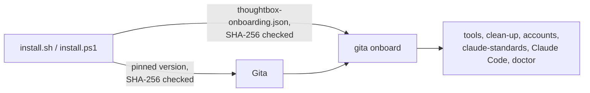

# dev-setup

One command to set up a ThoughtBox developer machine.

**Windows** (PowerShell):
```powershell
irm https://raw.githubusercontent.com/ThoughtBoxFinTechAI/dev-setup/main/install.ps1 | iex
```

**macOS / Linux:**
```bash
curl -fsSL https://raw.githubusercontent.com/ThoughtBoxFinTechAI/dev-setup/main/install.sh | bash
```

You'll be asked for your name, your **@thoughtbox.io** email and your **@thoughtbox.one**
email, and you'll sign in to GitHub twice: once per account. The rest is automatic. Run
it again any time: every step checks what is already there, keeps what works, and
repairs what is broken.

Macs need Apple silicon (M1 or later): the Gita command isn't built for Intel Macs yet.
Linux needs x86_64. Windows needs Windows 10 or later.

## How it works

The script installs [Gita](https://github.com/naseebnaushad/gita) (an open-source app,
not made by ThoughtBox) and hands over to it:



1. **The script** checks the computer, then installs the Gita version pinned at the top of
   the script, after checking its SHA-256. An older Gita is updated, one that doesn't run
   is reinstalled, and a newer one is kept. The app goes to `%LOCALAPPDATA%\Programs\Gita`,
   `~/Applications/gita.app` or `~/.local/share/gita`; the `gita` command to
   `~/.gita/bin` (added to PATH). Profiles and settings in `~/.gita` are kept.
2. **The script** downloads [`thoughtbox-onboarding.json`](thoughtbox-onboarding.json) from
   this repo, checks it against the SHA-256 pinned in the script, and runs
   `gita onboard` with it.
3. **Gita** does the rest ([what `gita onboard` does](https://github.com/naseebnaushad/gita/blob/master/docs/onboarding.md)):

| Step | Details |
|---|---|
| Tools | Git, GitHub CLI (optional) and Claude Code: installed if missing, reinstalled if they don't run. Windows: winget. macOS: Xcode tools + Homebrew. Linux: apt, dnf or pacman with sudo (also `secret-tool`, where Gita keeps sign-ins). |
| Clean-up | Old GitHub sign-ins that make git or gh use the wrong account: saved github.com logins (Windows Credential Manager, macOS Keychain, `~/.git-credentials`), `url.*.insteadOf` rules and sign-in headers for github.com, old credential helpers, GitHub CLI logins. Listed, then removed after you say yes, with a backup of `~/.gitconfig`. Gita's sign-ins, other sites and SSH keys are not touched. |
| Accounts | Gita profiles `ThoughtBox` (@thoughtbox.io) and `ThoughtBox AI` (@thoughtbox.one), each signed in to GitHub. Existing profiles with those emails are reused; an existing sign-in is kept after you confirm the account. |
| claude-standards | Cloned to `~/claude-standards` with the AI account (an existing clean copy is updated, one with local changes is kept, anything else is moved to `~/claude-standards.backup-<date>`), its Gita company files imported (`thoughtboxhub` → .io, `ThoughtBoxFinTechAI` → .one), then its setup run (rules, deny rules, company plugin). |
| Finish | Gita is connected to Claude Code and `gita doctor` checks everything. A summary shows every step. |

After it finishes: open a new terminal, run `claude` and sign in with your company seat.
For the GitHub CLI use `gita gh <command>` (for example `gita gh pr list`): it runs `gh` as
the right account for each project.

## Options

Set these environment variables before running:

| Variable | Effect |
|---|---|
| `TB_NAME`, `TB_EMAIL_IO`, `TB_EMAIL_ONE` | Answer the questions up front. |
| `TB_DRY_RUN=1` | Print what would change; change nothing. |
| `TB_CLEAN=1` | Remove old GitHub sign-ins without asking. Without a terminal and without this, nothing is removed. |
| `TB_LOG` | Where to write the log (default `~/.thoughtbox-setup.log`). |
| `TB_SKIP_SIGNIN=1`, `TB_SKIP_STANDARDS=1` | Skip GitHub sign-in, or claude-standards and its setup (for testing). |
| `TB_GITA_ZIP` (Windows), `TB_GITA_ARCHIVE` (macOS/Linux) | Install Gita from a local file instead of the release. No checksum check; for testing builds only. |
| `TB_ONBOARDING_FILE` | Use a local onboarding file instead of the one in this repo. No checksum check; for testing only. |

Windows example: `$env:TB_DRY_RUN='1'; irm .../install.ps1 | iex`.
macOS/Linux: `curl -fsSL .../install.sh | TB_DRY_RUN=1 bash`.

## When something goes wrong

- The setup stops with **"Setup stopped:"**, the reason and what to do. Fix that and run
  the same command again; finished steps are skipped.
- Every run writes a log to `~/.thoughtbox-setup.log`. Only you can read it, and no token is
  written to it. Send it when asking for help.
- **"claude-standards couldn't be downloaded"**: check these in order.
  1. **ThoughtBoxFinTechAI must approve the Gita app** (the most common cause). Signed in to
     github.com as your @thoughtbox.one account, open **Settings → Applications → Authorized
     OAuth Apps → Gita** and click **Request** next to ThoughtBoxFinTechAI. An org owner
     approves it under **Organization settings → Third-party access**. Then run the setup
     again.
  2. The `ThoughtBox AI` profile must be signed in as your @thoughtbox.one GitHub account.
     GitHub signs in whoever is logged in to github.com in your browser, so sign out there
     first (or use a private window), then run `gita sign-in --profile "ThoughtBox AI"` and
     the setup again.
  3. That account must be a member of ThoughtBoxFinTechAI. Ask an admin.
- **macOS `Killed: 9`**: run the setup again; it repairs Gita.
- If the clean-up signed out GitHub CLI, use `gita gh`, or run `gh auth login` with the
  right account for plain `gh`.
- Not changed automatically; check them yourself if git still uses the wrong account:
  `GH_TOKEN` / `GITHUB_TOKEN` set in your shell profile (or, on Windows, for all users),
  a `Host github.com` entry in your SSH settings (matters only for `git@github.com:`
  addresses), and other apps signed in to GitHub (your IDE, GitHub Desktop).

## For admins

### New Gita releases

The installers only install the exact Gita version and checksums pinned at the top of
each script. A workflow, **Update pinned Gita** (`.github/workflows/gita-bump.yml`), checks
every day (or when started by hand from the Actions tab) for a newer published Gita
release. When there is one, it checks every download against the release's `SHA256SUMS`,
starts the Linux build once, and opens a pull request that updates both scripts. It also
starts the installer tests on that branch. A person reviews and merges it.

It needs the repository setting **Allow GitHub Actions to create and approve pull
requests** (Settings → Actions → General). The same check can be run by hand:
`scripts/gita-bump.sh` (needs `gh`, signed in).

### Changing the onboarding steps

Edit `thoughtbox-onboarding.json` (format: [Gita's onboarding docs](https://github.com/naseebnaushad/gita/blob/master/docs/onboarding.md)),
then put its new SHA-256 in `ONBOARDING_SHA256` (`install.sh`) and `$OnboardingSha256`
(`install.ps1`) in the same pull request. CI fails if they don't match:

```bash
sha256sum thoughtbox-onboarding.json
```

This repo is public so the one-line command works without signing in. It must never
hold secrets, tokens or webhook URLs; those come from claude.ai managed settings.
