# dev-setup – Lifecycle and process flows

| | |
|---|---|
| Repository | `ThoughtBoxFinTechAI/dev-setup` (public) |
| Related | `ThoughtBoxFinTechAI/claude-standards` (private), `naseebnaushad/gita` (open source, not affiliated with ThoughtBox) |
| Written | 2026-11-09; updated the same evening for hotfix 0.2.1, and on 2026-11-11 after it was merged |
| State described | `main` after PRs #6, #5 and #4 were merged (2026-11-09 16:57), with Gita 1.1.1 pinned, plus hotfix 0.2.1 (PR #8, merged 2026-11-10 11:22); `main` brought into `develop` on 2026-11-11 |

This document explains, with labelled diagrams, **what goes where and when**: how a
developer machine is set up, where every file lands, how Gita versions are pinned, how
changes move through branches into `main`, what CI checks, and what we did to get here.
Every figure has a "Who / What / Where / When" table under it.

Contents:
1. [The big picture: three repositories](#1-the-big-picture-three-repositories)
2. [Setting up a developer machine before `gita onboard` (hotfix 0.1.1, replaced)](#2-setting-up-a-developer-machine-before-gita-onboard-hotfix-011-replaced)
3. [Setting up a developer machine with `gita onboard` (on `main`)](#3-setting-up-a-developer-machine-with-gita-onboard-on-main)
4. [GitHub sign-in, organization approval and the claude-standards download](#4-github-sign-in-organization-approval-and-the-claude-standards-download)
5. [Clean-up of old GitHub sign-ins](#5-clean-up-of-old-github-sign-ins)
6. [What goes where on a developer machine](#6-what-goes-where-on-a-developer-machine)
7. [Gita version pinning lifecycle](#7-gita-version-pinning-lifecycle)
8. [Changing the onboarding steps](#8-changing-the-onboarding-steps)
9. [Branches, pull requests and releases](#9-branches-pull-requests-and-releases)
10. [CI: what is checked on every pull request](#10-ci-what-is-checked-on-every-pull-request)
11. [Troubleshooting decision tree](#11-troubleshooting-decision-tree)
12. [What we did: timeline](#12-what-we-did-timeline)
13. [Open pull requests and merge order](#13-open-pull-requests-and-merge-order)
14. [Not done or not verified](#14-not-done-or-not-verified)

---

## 1. The big picture: three repositories

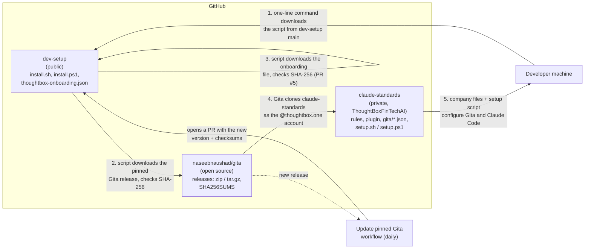

*Figure 1 – The three repositories and what flows between them.*

| Who / what | What moves | Where | When |
|---|---|---|---|
| Developer | Runs the one-line command | Terminal → `raw.githubusercontent.com/.../dev-setup/main/install.*` | Once per machine; again any time to repair |
| Setup script | Downloads Gita at the pinned version, checks SHA-256 | GitHub releases of `naseebnaushad/gita` | Every run (skipped when the right Gita is installed) |
| Setup script (PR #5) | Downloads `thoughtbox-onboarding.json`, checks SHA-256 | `dev-setup/main` | Every run |
| Gita | Clones claude-standards with the `.one` account | `~/claude-standards` | First run; later runs update it |
| claude-standards | Company files and setup script | Gita settings, `~/.claude/` | Every run |
| Update pinned Gita workflow | PR with new version + checksums | `dev-setup` | Daily, when Gita has a newer published release |

---

## 2. Setting up a developer machine before `gita onboard` (hotfix 0.1.1, replaced)

This is what `main` did after PR #6 (hotfix 0.1.1) was merged, until PR #5 replaced it
minutes later on 2026-11-09 (Figure 3). The script did every step itself. It is kept
here because the steps are the same ones Gita now runs.

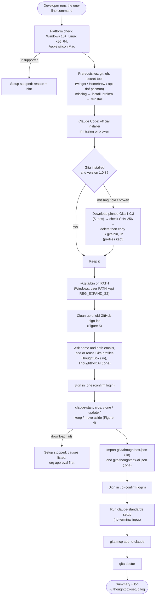

*Figure 2 – Setup flow of hotfix 0.1.1 (`install.sh`, `install.ps1` on `main`).*

| Who / what | What | Where | When |
|---|---|---|---|
| `install.sh` / `install.ps1` | All steps above | Developer machine | Each run; finished steps are skipped |
| Log | Everything printed, no tokens | `~/.thoughtbox-setup.log` (owner-only) | Rewritten each run |
| Exit code | 0 done, 1 a step stopped | Terminal / CI | End of run (no `exit` under `irm \| iex`) |

---

## 3. Setting up a developer machine with `gita onboard` (on `main`)

Since PR #5 (merged into `main` on 2026-11-09), the script only installs Gita and hands
over. Gita does the work from `thoughtbox-onboarding.json`. The Figma MCP Bridge (PR #4)
stays in this repo as an optional step after Gita. Hotfix 0.2.1 (PR #8) adds the
Windows step that puts Claude Code's folder on PATH (blue boxes).

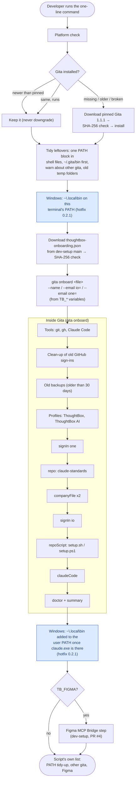

*Figure 3 – Setup flow after PR #5: the script installs Gita; `gita onboard` does the rest.*

| Who / what | What | Where | When |
|---|---|---|---|
| Script | Gita install, leftovers, onboarding file, Figma step | `install.sh`, `install.ps1` in this repo | Each run |
| `thoughtbox-onboarding.json` | ThoughtBox's accounts and steps | This repo, served from `main` | Downloaded each run, checked against `ONBOARDING_SHA256` / `$OnboardingSha256` |
| `gita onboard` | Tools, clean-up, backups, accounts, repo, company files, setup script, Claude Code, doctor | Gita (generic, open source) | Each run |
| `Add-ClaudeBinToPath` (Windows only) | Puts `~\.local\bin`, where Claude Code's installer puts `claude.exe`, on this terminal's PATH before Gita runs (so the claude-standards setup finds `claude`), and on the user PATH afterwards | `install.ps1` | Each run; does nothing when already there (hotfix 0.2.1) |

---

## 4. GitHub sign-in, organization approval and the claude-standards download

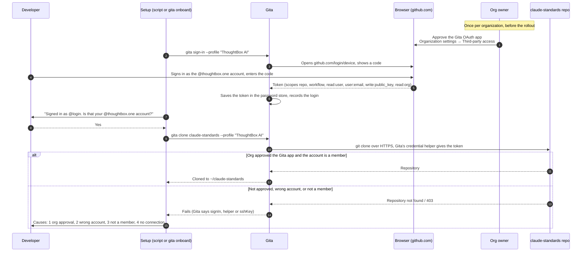

*Figure 4 – Sign-in and the claude-standards download. Without the organization's
approval of the Gita OAuth app, the token can't see the private repository.*

| Who | What | Where | When |
|---|---|---|---|
| Org owner of `ThoughtBoxFinTechAI` and `thoughtboxhub` | Approves the Gita OAuth app | GitHub → Organization settings → Third-party access | Once per organization; before anyone runs the setup |
| Developer | Signs in as the right account | Browser, device code page | First run, or when asked to sign in again |
| Gita | Keeps the token per profile | Windows Credential Manager, macOS Keychain, Linux secret-tool | At sign-in |
| Setup | Clones, updates, keeps or moves aside `~/claude-standards` | Developer machine | Each run |

---

## 5. Clean-up of old GitHub sign-ins

Old saved sign-ins make git use the wrong account even after Gita signs in (this
broke a developer's setup on Windows).

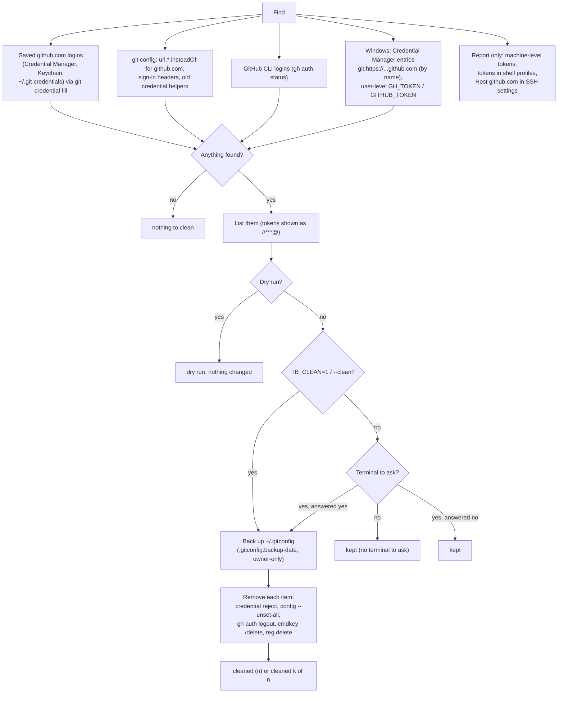

*Figure 5 – Clean-up of old GitHub sign-ins (script in 0.1.1; `gita onboard` after PR #5).
Gita's own sign-ins, other sites and SSH keys are never touched.*

| What | Where | When |
|---|---|---|
| Backup of `~/.gitconfig` | `~/.gitconfig.backup-YYYYMMDD-HHMMSS` | Before anything is removed |
| Old backups (can hold removed tokens) | Offered for deletion when older than 30 days, newest kept | Each `gita onboard` run (PR #5) |

---

## 6. What goes where on a developer machine

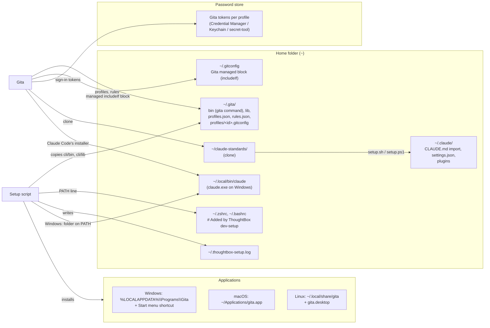

*Figure 6 – Where each file lands.*

| Item | Path | Written by | When |
|---|---|---|---|
| Gita app | `%LOCALAPPDATA%\Programs\Gita`, `~/Applications/gita.app`, `~/.local/share/gita` | Setup script | Install / update |
| `gita` command | `~/.gita/bin`, `~/.gita/lib` | Setup script | Install / update (deleted, then copied) |
| PATH | Shell files (one marked block) / Windows user PATH (REG_EXPAND_SZ) | Setup script | Install; tidied on later runs (PR #5) |
| Profiles, rules | `~/.gita/*.json`, `~/.gita/profiles/*.gitconfig` | Gita | Profile add, sign-in, company import |
| Managed git settings | `~/.gitconfig` block "Gita managed rules" | Gita | Rules change |
| Tokens | Password store, one per profile | Gita | Sign-in |
| claude-standards | `~/claude-standards` | Gita clone | First run; updated later |
| Claude Code company setup | `~/.claude/` | claude-standards setup | Each run |
| Claude Code program | `~/.local/bin/claude` (`claude.exe` on Windows); on Windows the folder goes on the user PATH | Claude Code's installer, started by Gita; PATH by the setup script | First run; PATH from hotfix 0.2.1 |
| Log | `~/.thoughtbox-setup.log` | Setup script | Each run |

---

## 7. Gita version pinning lifecycle

The scripts only install the exact Gita version and checksums written in them.

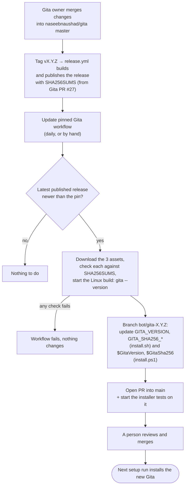

*Figure 7 – From a Gita release to every developer machine. The hotfix 0.1.1 pin (1.0.3)
was checked by hand against GitHub's release digests and the downloads.*

| Who / what | What | Where | When |
|---|---|---|---|
| Gita owner | Tags and publishes a release | `naseebnaushad/gita` | When Gita changes |
| `.github/workflows/gita-bump.yml` + `scripts/gita-bump.sh` | Checks, updates pins, opens PR | This repo, branch `bot/gita-X.Y.Z` | Daily 05:23 UTC, or "Run workflow" |
| Repository setting | "Allow GitHub Actions to create and approve pull requests" | Settings → Actions → General | Once (needed by the bot) |
| Reviewer | Merges the bot PR | GitHub | After the installer tests pass |

---

## 8. Changing the onboarding steps

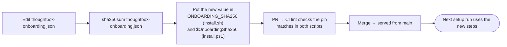

*Figure 8 – Changing ThoughtBox's onboarding steps (PR #5). The file format is Gita's,
documented in Gita's `docs/onboarding.md`; only fixed step types are allowed.*

---

## 9. Branches, pull requests and releases

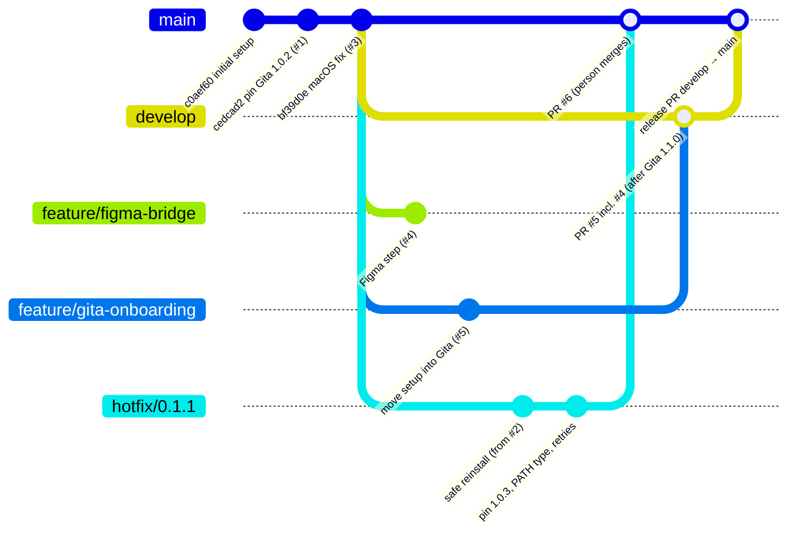

*Figure 9 – Branch model as it applies here. Merges are done by a person on GitHub.*

| Branch | Purpose | Merges into | Who merges | When |
|---|---|---|---|---|
| `main` | What the one-line command serves | — | — | — |
| `develop` | Next version | `main` via a release PR | Person, after `/promote release` | When stable |
| `feature/...`, `fix/...` | Work | `develop` | Person, after review | When green |
| `hotfix/X.Y.Z` | Urgent fix of `main` | `main`, then the same change into `develop` | Person | As soon as green |
| `bot/gita-X.Y.Z` | New Gita pin | `main` | Person | After installer tests |

Rules that apply: commits only when the developer asks; no direct pushes to `main` or
`develop`; Claude never merges a PR; every PR has an explicit base; every branch has a
change note in `documents/unreleased/<branch>.md`.

---

## 10. CI: what is checked on every pull request

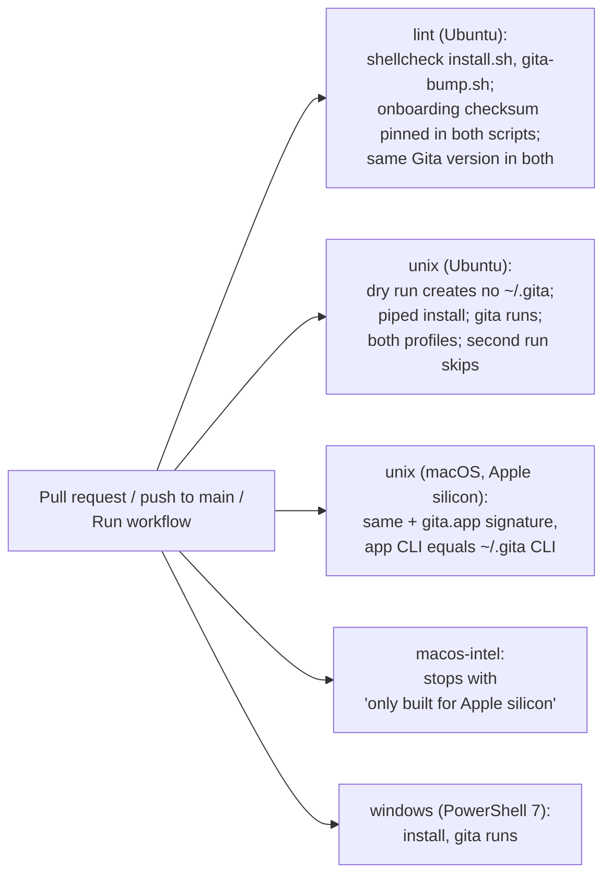

*Figure 10 – `.github/workflows/test-install.yml`. Sign-in and claude-standards are skipped
in CI (they need a person and the private repo).*

---

## 11. Troubleshooting decision tree

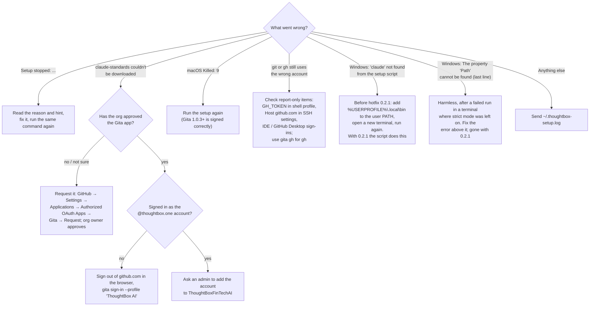

*Figure 11 – What to do when something goes wrong.*

---

## 12. What we did: timeline

| Date | Repo | What | State |
|---|---|---|---|
| 2026-11-06 | dev-setup | First one-command setup for Windows, macOS, Linux (`c0aef60`) | On `main` |
| 2026-11-07 | Gita | Releases 1.0.0 – 1.0.2 (MIT licence, installers) | Released |
| 2026-11-07 | dev-setup | PR #1: pin Gita 1.0.2 | Merged |
| 2026-11-07 | dev-setup | PR #2: safe reinstall, clean-up of old sign-ins, clear errors; org-approval hint after a developer's clone failed | Closed, replaced by #6 |
| 2026-11-08 | dev-setup | PR #3: macOS re-sign (`Killed: 9`), Intel stop, installer CI | Merged |
| 2026-11-08 | dev-setup | PR #4: optional Figma MCP Bridge step | Merged into `main` 2026-11-09 16:57 |
| 2026-11-09 | Gita | PRs #21–#25: macOS entitlement, macOS tests, `gita gh`, `gita` on PATH, clone sign-in messages; release 1.0.3 | Merged, released |
| 2026-11-09 | Gita | PR #27: `gita onboard`, clean-up, old backups, `read:org`, `SHA256SUMS` | Merged; released as 1.1.0, then 1.1.1 |
| 2026-11-09 | claude-standards | PR #3 (docs and versioning) and the `gita gh` guard (PR #4, merged as PR #6) | Merged into `main` |
| 2026-11-09 | dev-setup | PR #6: hotfix 0.1.1 – #2's work + Gita 1.0.3, Windows PATH type kept, 5 download retries | Merged into `main` 16:57 |
| 2026-11-09 | dev-setup | PR #5: move the setup into `gita onboard`; bump bot; CI checks; Gita 1.1.1 pinned | Merged into `main` 16:57 |
| 2026-11-09 18:32 | dev-setup | A developer's Windows run: Gita 1.1.1, clean-up, both sign-ins and the claude-standards download all worked; the claude-standards setup stopped with `'claude' not found`. A second run, after running Claude Code's installer by hand, also ended with `The property 'Path' cannot be found` | Diagnosed |
| 2026-11-09 | dev-setup | PR #7 (`fix/windows-claude-path` → `main`): the fix for both | Closed: a `fix/` branch may not go into `main` |
| 2026-11-09 | dev-setup | PR #8 (`hotfix/0.2.1` → `main`): the same fix; change note renamed `hotfix-0.2.1.md` | Merged into `main` 2026-11-10 11:22 |
| 2026-11-10 | claude-standards | PR #7: its `setup.ps1` also looks in `~\.local\bin` for `claude` | Merged into `main` 11:22 |
| 2026-11-10 | dev-setup | A second Windows run (new local account): everything set up, including the PATH fix; only the optional Figma step stopped because `winget` is missing on that account | Workaround given; see section 14 |
| 2026-11-10 | Gita | PR #31: rerunning `gita onboard` repairs an old or incomplete company repository copy | Merged into `master`; not released yet (planned 1.1.2) |
| 2026-11-11 | Gita | PR #32: notice cancelled GitHub sign-ins (GitHub keeps 10 per account per app) and skip needless sign-ins | Open; planned 1.2.0 |
| 2026-11-11 | dev-setup | `main` (hotfixes 0.1.1 and 0.2.1, #4, #5) brought into `develop` through `fix/main-into-develop` | Merged into `develop` |

Incidents and fixes recorded in the Change Requests:
- A Gita test run on Windows was not isolated: it changed a real `~/.gita` and showed a real
  token. Cleaned up with a backup; the test now refuses to run unless isolated; the token
  is to be revoked.
- The old scripts turned the Windows user PATH into REG_SZ with expanded variables. Fixed
  in 0.1.1 and #5.
- Claude Code's Windows installer leaves `~\.local\bin` off PATH, so the claude-standards
  setup could not find `claude`. Fixed in hotfix 0.2.1.
- The script's last line read `$MyInvocation.MyCommand.Path`, which does not exist under
  `irm | iex`; with strict mode left on in the terminal that is an error. Fixed in 0.2.1.

---

## 13. Open pull requests and merge order

State on 2026-11-11. Green boxes are done; the rest are still to do.

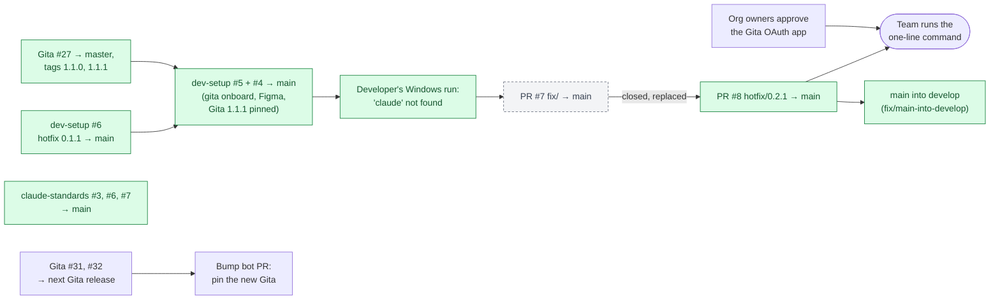

*Figure 12 – Pull requests and what is left. Every merge is done by a person.*

| Order | Item | Needs |
|---|---|---|
| done | dev-setup #8 (hotfix 0.2.1 → `main`) | Merged 2026-11-10 11:22 |
| done | `main` into `develop` | PR from `fix/main-into-develop` (the hotfix rule; #4, #5 and #6 also went straight into `main`) |
| 1 | Org approval of the Gita app | Org owners of `thoughtboxhub` and `ThoughtBoxFinTechAI` |
| 2 | Next Gita release (1.1.2 with #31, or 1.2.0 with #32) | Gita owner tags it; the bump bot then opens the pin PR here |
| later | First `/promote` (adds `VERSION`, tags) | Release owner |

---

## 14. Not done or not verified

- No run on a real Mac by a person (CI's macOS job passes for 0.1.1).
- Interactive prompts (questions, browser sign-in) are not tested automatically.
- The bump bot has not run on GitHub yet (needs the repository setting).
- dev-setup has no `VERSION` file and no tags yet; the hotfix numbers 0.1.1 and 0.2.1
  were chosen by hand until the first `/promote`.
- Hotfix 0.2.1 was checked by a strict-mode `iex` test and a parse check on Windows
  PowerShell 5.1, plus its new CI checks, and by a developer's full run on a new Windows
  account on 2026-11-10 (the log shows "Added ~\.local\bin (Claude Code) to your user PATH").
- The optional Figma step needs `winget`. On a newly created Windows account the App
  Installer package (which holds `winget`) may not be registered yet, so the step stops
  with "winget is needed for this step". Workaround: run
  `Add-AppxPackage -RegisterByFamilyName -MainPackage Microsoft.DesktopAppInstaller_8wekyb3d8bbwe`
  (or install App Installer from the Microsoft Store), open a new terminal, and rerun with
  `TB_FIGMA=1`. The script does not do this by itself yet.
