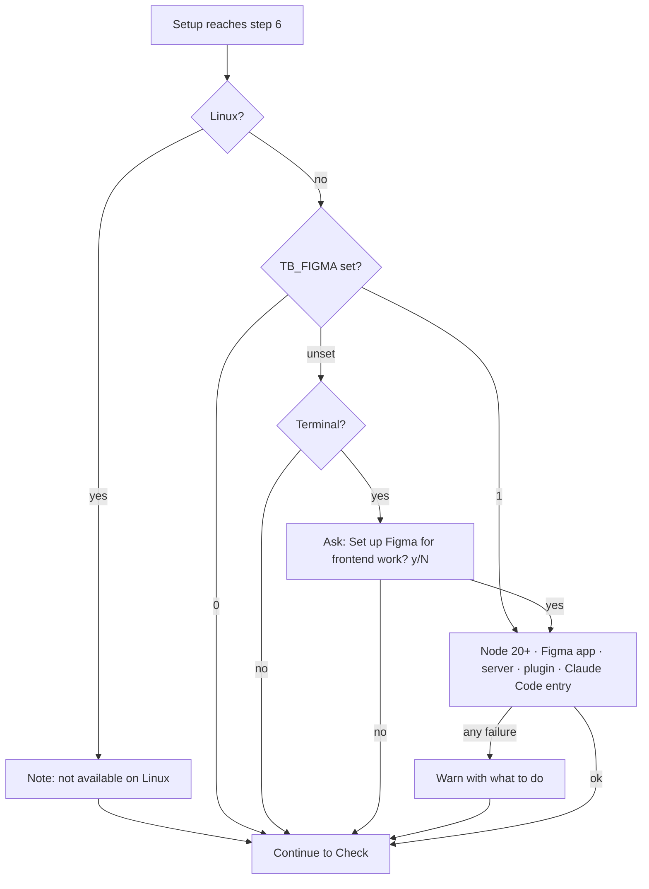

# v0.1.0 - Change Request: Optional Figma MCP Bridge setup

| | |
|---|---|
| **CR id** | CR-0.1.0-02 |
| **Version** | 0.1.0 (target; Alpha) |
| **Status** | In progress |
| **Owner** | Naseeb Naushad |
| **Branch** | `feature/figma-bridge` |
| **Date** | 2026-11-09 |

## 1. Summary
Figma's own API and MCP allow free accounts only a few requests a month, which blocks
Claude-driven design work. The [Figma MCP Bridge](https://github.com/gethopp/figma-mcp-bridge)
avoids that limit: a Figma plugin streams the open file to a local MCP server on the
developer's machine. Each developer needs their own bridge, and they all work on the same
shared Figma file. This change adds an **optional** step to `install.ps1` and `install.sh`
so a frontend developer gets the bridge ready with one "yes".

## 2. Answers to the clarifying questions
| Topic | Answer |
|---|---|
| Goal | Frontend developers can use Claude with the team's shared Figma files without hitting Figma's API limits, with no manual install. |
| Users | Frontend developers on Windows and macOS. Linux: not supported (no Figma desktop app; the bridge needs it). |
| In scope | Asking whether to set it up; Node.js 20+; Figma desktop app; the pinned bridge server; the pinned, checksum-checked plugin; registering `figma-bridge` with Claude Code; clear next steps; README; CI. |
| Out of scope | Importing the plugin into Figma (Figma has no way to script this; the developer does it once); Claude Desktop, Cursor and Codex configuration; Figma accounts, file sharing and seats; Linux. |
| Edge cases | No terminal to ask (piped/CI): treated as "no" unless `TB_FIGMA=1`. Node missing or older than 20. No Homebrew on macOS. winget missing. Download checksum mismatch. Claude Code not on PATH. An older bridge version already installed. A `figma-bridge` entry already in Claude Code. Dry run. |
| Constraints | Optional: a failure in this step warns and the rest of the setup still finishes. Pinned versions with checksums, like Gita. No secrets. Same behaviour in both scripts. `run_script` **on** (developer's decision, see D5). |
| Definition of done | Both scripts install and register the bridge when asked, skip it when not, re-runs skip finished work, dry run changes nothing; CI covers yes and no on Windows and macOS; README and this CR updated; change note written. |

## 3. Impact analysis
| Area / file | How it is affected | Action |
|---|---|---|
| `install.ps1` | New pinned values, new optional step 6 (before "Check"), new "Next" lines, header comment lists `TB_FIGMA`. | change |
| `install.sh` | Same as above. Linux prints that the step isn't available. | change |
| `README.md` | "What it does" row, `TB_FIGMA` option, troubleshooting, admin steps to move to a new bridge version. | change |
| `.github/workflows/test-install.yml` | New jobs run `TB_FIGMA=1` on Windows and macOS and check the files and the Claude Code entry. Existing jobs stay "no" (no terminal). CI change: approval asked through this CR. | change |
| `documents/README.md` | Created (main has no `documents/` yet). | change |
| `documents/unreleased/feature-figma-bridge.md` | Change note. | change |
| Open PR #2 (`fix/setup-reinstall-and-errors`) | Rewrites both scripts and README and adds `documents/README.md`. Whichever merges second will need a merge of those files. The new step is one self-contained block, so the merge is mechanical. | none now; merge later |
| `claude-standards` setup, Gita, accounts | Not touched. | none |
| Developer's `~/.claude.json` | Gains a user-scoped `figma-bridge` MCP server. | change (by script) |

Suggested related improvements (not in scope unless approved):
- Ship an npm lockfile for the bridge so its sub-dependencies are pinned too (see D3).
- Offer the same step for Cursor/Claude Desktop users.

## 4. Design

What lands on the machine (all under `~/.thoughtbox/figma-mcp-bridge/`):

| Path | What |
|---|---|
| `server/` | `npm install` of `@gethopp/figma-mcp-bridge@<pinned>` from the checked tarball, `--ignore-scripts` |
| `plugin/manifest.json`, `plugin/dist/` | The Figma plugin from the pinned, checked release zip |
| `version` | The installed version, so a re-run skips or upgrades |

Claude Code entry (user scope), replaced if it differs:
`claude mcp add figma-bridge -s user -e FIGMA_BRIDGE_ENABLE_RUN_SCRIPT=1 -- <absolute node path> <server>/node_modules/@gethopp/figma-mcp-bridge/dist/index.js`

Final message tells the developer to open the Figma desktop app → **Plugins → Development →
Import plugin from manifest…** → pick `plugin/manifest.json`, then open the shared file,
run the plugin, and restart `claude`.

### Decisions
| # | Decision | Reason | Alternatives considered |
|---|---|---|---|
| D1 | Ask `y/N`, default No; `TB_FIGMA=1/0` answers up front; no terminal = No. | Most developers aren't frontend; CI and piped runs stay unchanged. (Developer's choice.) | Env var only. |
| D2 | Install Node.js LTS and the Figma desktop app if missing (winget `OpenJS.NodeJS.LTS`, `Figma.Figma`; Homebrew `node`, `--cask figma`). | The bridge needs Node 20+ and the plugin only runs in the desktop app. (Developer's choice.) | Only check and explain. |
| D3 | Pin the server version and check the npm tarball's SHA-512 against a value in the script; pin the plugin zip by SHA-256. | Same supply-chain protection as Gita. Sub-dependencies still follow the package's semver ranges: noted as a risk. | `npx -y @pkg` (unpinned, downloads on every start). |
| D4 | Install into a fixed folder and run it with an absolute `node` path. | No `npx`/`cmd /c` quirks on Windows; works no matter how Claude Code is started. | `npx` in the MCP entry. |
| D5 | `FIGMA_BRIDGE_ENABLE_RUN_SCRIPT=1`. | Developer's choice: matches the current team setup and lets Claude make larger edits. Risk: the agent can run any Plugin API code in an open file the developer can edit. README says how to turn it off. | Off (project default). |
| D6 | Failures in this step warn and continue; they never stop the setup. | It's optional; the core setup must still finish. | Stop the setup. |
| D7 | Linux: skip with a note. | No Figma desktop app on Linux. | Install anyway. |

## 5. Feature parity
Not a rewrite. Existing steps are unchanged; with no terminal and no `TB_FIGMA` the
scripts behave exactly as before.

## 6. Security checklist
- [x] Input validated: the answer accepts only y/yes (anything else = No); `TB_FIGMA` only `1`/`0`, anything else warns and skips (FIGMA-002)
- [x] Output encoded for context: n/a (terminal output only)
- [x] AuthN/AuthZ: n/a. The bridge listens on `localhost:1994` only; the plugin's manifest allows only `ws://localhost:1994`
- [x] Secrets never logged/committed: none involved; no tokens, keys or URLs with credentials in the change
- [x] Errors: messages say what to do; no personal data printed
- [x] TLS + timeouts: HTTPS from github.com and registry.npmjs.org; plugin download has a 120 s timeout (`-TimeoutSec` / `curl --max-time`)
- [x] Downloads checked against pinned checksums before anything is installed (FIGMA-008)
- [x] New dependencies: licences MIT (bridge, plugin, Node.js); actively maintained (release 2026-10-21)
- [ ] Vulnerability scan clean: **no**. `npm audit` on the pinned install reports high-severity GHSA-mrhx-c7xc-m3w5 in `zod` 3.25.76 (memory exhaustion on very large inputs), no fix available. Input reaches it only from the local agent (stdio) and the local plugin, so the impact is a local crash. **Accepted risk pending developer confirmation**; recorded in README "Known issue".
- [x] `run_script` risk recorded (D5) and documented in README

## 7. Dependencies
Installed on developer machines only when they answer yes; nothing is added to this repo.

| Package | Version | Licence | Why needed |
|---|---|---|---|
| `@gethopp/figma-mcp-bridge` (npm) | 0.0.25 | MIT | The MCP server |
| Figma MCP Bridge plugin (GitHub release zip) | 0.0.25 | MIT | Runs inside Figma, streams the file to the server |
| Node.js | LTS (≥ 20) | MIT | Runs the server |
| Figma desktop app | latest | Proprietary (free to install) | The plugin needs it |

## 8. Test approach
- CI (Windows and macOS): `TB_FIGMA=1` installs Node, the server and the plugin, adds the
  Claude Code entry (`claude mcp get figma-bridge`), and a second run skips it. The
  existing jobs prove "no" is the default without a terminal. Linux prints the skip note.
- CI: dry run with `TB_FIGMA=1` creates nothing.
- Manual on this Windows PC: run with `TB_FIGMA=1`, import the plugin, open the shared
  file, check Claude sees it (`list_files`). Manual on a Mac by a frontend developer.
- Test case IDs `FIGMA-001`… in the Alpha Test Cases.

## 9. Open questions
- None blocking. Lockfile for sub-dependencies: suggested, not in scope.

## 10. Change history
| Date | Version | Change |
|---|---|---|
| 2026-11-09 | 0.1.0-alpha | CR created |
| 2026-11-09 | 0.1.0-alpha | Approved by Naseeb Naushad; work started |
| 2026-11-09 | 0.1.0-alpha | Implemented; Windows and bash logic tested (FIGMA-001…009); `zod` advisory found and recorded; CI and manual Figma check pending |
