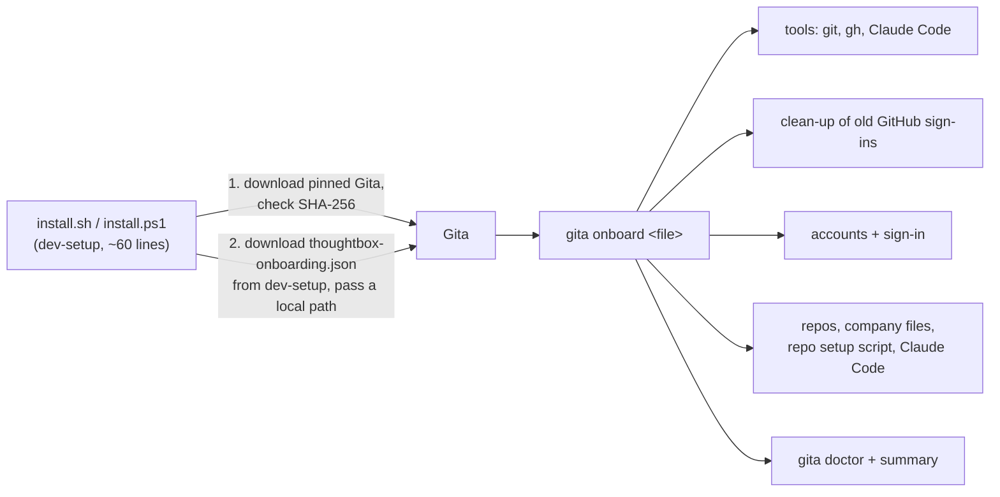

# v0.2.0 - Change Request (Move setup into Gita)

## 1. Summary

Today two scripts (`install.sh`, `install.ps1`, about 900 lines each) do the whole
developer setup. They are hard to keep the same on two shells, and Gita already owns most
of what they configure. This change moves the work into Gita as **generic** features, so
the scripts only download Gita and hand over:



**Gita is open source and not affiliated with ThoughtBox.** Nothing ThoughtBox-specific
goes into the Gita repo: no company names, org names, emails or internal documents. Gita
gets features any company can use, documented in its own `docs/` style. Everything
ThoughtBox-specific stays in dev-setup and claude-standards.

## 2. Decisions already made by the developer

| # | Decision |
|---|---|
| A1 | Generic `gita onboard` command driven by a file, not a ThoughtBox-only command. |
| A2 | All of these move into Gita: clean-up of old sign-ins; accounts and sign-in; repos and company setup; installing/repairing git, gh and Claude Code. |
| A3 | A `gita gh` wrapper is part of this change. |
| A4 | The onboarding file may only use **fixed step types**, never free-form commands. |
| A5 | Gita reads the onboarding file from a **local path only**; it never fetches URLs. |
| A6 | Sign-in asks for `read:org` too; `gita gh` asks to sign in again only when a command needs it. |
| A7 | On Linux Gita shows the `sudo` command and runs it, so sudo asks for the password; with no terminal it prints the command instead. |
| A8 | Latest Gita: a daily bot PR in dev-setup updates the pinned version and checksums (people merge it); a newer installed Gita is never downgraded; only published, non-pre-release releases count. |
| A9 | Gita keeps its own repo conventions. This CR, the test cases and change notes live in dev-setup `documents/`. |
| A10 | Leftovers of earlier runs are cleaned up. Old backups (`~/.gitconfig.backup-<date>`, which can still hold removed tokens, and `<repo>.backup-<date>` folders) older than 30 days are listed and deleted after the person says yes; the newest of each is always kept; with no terminal they are only listed. |
| A11 | Split by owner: Gita (generic) handles the backups it makes, as an `onboard` step. The dev-setup scripts handle ThoughtBox leftovers: repeated `# Added by ThoughtBox dev-setup` PATH blocks (one block, moved to the end of the shell file), old `tb-gita` temp folders. |
| A12 | Another `gita` earlier on PATH: the scripts fix the PATH order (`~/.gita/bin` first: last block in the shell files, first entry of the Windows user PATH) and warn with its path. A `gita` in the Windows system PATH can't be overridden by the user PATH: warning only. Files the script didn't install are never deleted. |

## 3. Scope

### In scope

**Gita (generic, open source)** – new minor version, 1.1.0:
1. `gita onboard <file>`: reads an onboarding file (§5), shows the plan, then runs the
   steps with the same safety the scripts have today: check first, keep what works,
   repair what is broken, a summary of every step, clear errors, safe to re-run,
   `--dry-run`, `--yes` (no questions), `--json`.
2. Tool checks and installs: git, gh, Claude Code. winget (Windows), Homebrew and Xcode
   tools (macOS), apt / dnf / pacman with sudo (Linux), the official Claude Code installer.
   Reinstall when present but broken.
3. `gita cleanup` (also a step of `onboard`): finds and removes old GitHub sign-ins that
   make git or gh use the wrong account. Same rules as dev-setup v0.1.0 (saved logins,
   `insteadOf`, auth headers, old helpers, gh logins, Windows Credential Manager entries,
   user-level token variables; report-only items), with a `~/.gitconfig` backup.
4. Account step: find-or-add a profile per account, sign in, confirm the GitHub login,
   refuse the same login on two accounts.
5. Repo step: clone, or update a clean copy (`pull --ff-only`), keep a copy with local
   changes, move anything else aside; on failure remove the partial copy and list causes,
   with "the organization hasn't approved the Gita app" first.
6. `gita gh <args>`: runs the GitHub CLI with the token of the profile that matches the
   current repo (or `--profile`), through `GH_TOKEN` for that one process only.
7. `read:org` added to the sign-in scopes.
8. Fix the macOS `Killed: 9` at the source: `macos/scripts/bundle_cli.sh` signs the
   command with the `com.apple.security.cs.allow-unsigned-executable-memory` entitlement.
9. Publish a `SHA256SUMS` file with every release (used by the dev-setup bot, §6 D6).
10. Docs: README command list, scopes, `docs/company-rollout.md` (onboarding section),
    `claude-plugin/skills/gita/SKILL.md`, `_usage()`; MCP tools `gita_onboard` (dry run /
    plan only) and `gita_gh` are **out** of scope (see §3 Out).

**dev-setup** – v0.2.0:
1. `install.sh` / `install.ps1` shrink to: platform check (incl. the Intel Mac stop),
   download the pinned Gita and check its SHA-256, install it (never downgrade), download
   `thoughtbox-onboarding.json` from this repo next to the script, run
   `gita onboard <local file>`. Same one-line commands as today.
2. `thoughtbox-onboarding.json` (§5): the two accounts, claude-standards, its company
   files and setup script, Claude Code, and the optional Figma MCP Bridge (see Q1).
3. `.github/workflows/gita-bump.yml`: daily, opens a PR when Gita has a newer published
   release, with the new version and checksums (checked against `SHA256SUMS`, and the
   Linux build smoke-tested with `gita --version`).
4. `test-install.yml` updated for the new messages and flow.
5. README, test cases and change note. (No `.env.example`: nothing reads a `.env` file.)

**claude-standards:**
1. `tool-guard.sh`: treat `gita gh …` exactly like `gh …` (PR merge, PR create without
   `--base`, release create, repo delete/edit). Today `gita gh pr merge` would get past it.
2. `global/CLAUDE.md` §9: use `gita gh` for PRs and issues, so the account check
   (`gh auth status`, `gh auth switch`) is no longer needed. **Needs the developer's
   explicit approval** (rule §10: Claude never edits `CLAUDE.md` unasked).
3. README: install through dev-setup's one-line command; the manual steps stay as a
   fallback.

### Out of scope
- A full replacement for the GitHub CLI (`gita gh` wraps it).
- MCP tools for `onboard` and `gh` (a later change).
- Universal (Intel) macOS build of Gita; Linux arm64.
- Removing the pinned checksum: the scripts keep pinning (A8).
- Any change to how Gita stores tokens.

## 4. Impact analysis

| Area | What depends on it | Effect |
|---|---|---|
| Gita `company_setup.dart` | Company files, the app's "Import company setup", doctor | **Not changed.** The onboarding file is a separate format that *references* company files, because old Gita ignores unknown keys and `toJson` would drop new fields. |
| Gita `profile add` | Scripts, MCP | Not idempotent (fails if the email exists); `onboard` gets its own find-or-add. Existing command unchanged. |
| Gita `sign-in`, device flow | App, CLI, MCP | Scope list grows by `read:org`; existing tokens keep working for git. Test `github_device_flow_test.dart:31` and README scopes change. |
| Gita `clone` | App, CLI, MCP | New update/keep/move-aside logic lives in the onboarding repo step; `clone` itself unchanged except a better error for an unapproved OAuth app. |
| Gita `bundle_cli.sh` (macOS) | Every macOS release | Signing gains the entitlement; dev-setup's `fix_macos_cli_signature` becomes a no-op and is removed once that release is pinned. |
| Gita `release.yml` | Releases | Adds `SHA256SUMS`. |
| Gita checkout | – | The local copy is on `feat/agent-control`, 11 commits behind `master`. Work starts from `origin/master` in a separate worktree. |
| dev-setup scripts | The one-line commands, CI | Rewritten (§8 parity). PR #2 (v0.1.0) stays the working version until Gita 1.1.0 is released and pinned. |
| dev-setup working copy | **Uncommitted Figma MCP Bridge work** on `feature/figma-bridge` | Must not be lost (Q1). |
| dev-setup CI `test-install.yml` | Greps exact messages | Updated with the new messages. |
| claude-standards `gita/*.json`, `setup.sh/.ps1` | Imported / run by onboarding | Unchanged. `setup.sh` keeps running without terminal input (PR #3 finding: `claude plugin` crashes on macOS with tty input). |
| claude-standards `tool-guard.sh` | Company guard | Must match `gita gh` (gap found). |
| claude-standards `global/CLAUDE.md` | Every repo's rules | Wording for `gh` → `gita gh`; only with approval. |

## 5. Onboarding file format (generic)

A JSON file, at most 64 KB, UTF-8, unknown keys are an error (so a typo isn't silently
ignored). Strings are length-limited and control characters are rejected.

```json
{
  "format": 1,
  "name": "Example Co",
  "tools": { "git": "required", "gh": "optional", "claude": "required" },
  "cleanup": "ask",
  "accounts": [
    { "id": "work", "label": "Example", "emailDomain": "example.com",
      "question": "Your @example.com email" },
    { "id": "lab",  "label": "Example Lab", "emailDomain": "example-lab.com" }
  ],
  "steps": [
    { "type": "signIn",  "account": "lab" },
    { "type": "repo",    "account": "lab", "url": "https://github.com/example-lab/handbook.git",
      "dir": "~/handbook" },
    { "type": "companyFile", "account": "work", "repoDir": "~/handbook", "path": "gita/work.json" },
    { "type": "companyFile", "account": "lab",  "repoDir": "~/handbook", "path": "gita/lab.json" },
    { "type": "signIn",  "account": "work" },
    { "type": "repoScript", "repoDir": "~/handbook", "windows": "setup.ps1", "unix": "setup.sh" },
    { "type": "claudeCode" },
    { "type": "doctor" }
  ]
}
```

| Step type | What it does | Limits |
|---|---|---|
| `signIn` | Sign the account's profile in; confirm the login; refuse a login another account uses. | – |
| `repo` | Clone with the account's profile, or update / keep / move aside an existing copy. | https `github.com` (or the account's GitHub host) URLs only; `dir` must be inside the home folder. |
| `companyFile` | `gita company import` a file from a cloned repo, for that account. | Path must stay inside `repoDir` (no `..`, no links out). |
| `repoScript` | Run a script that is inside a cloned repo, after showing its path and asking (or `--yes`). No terminal input is given to it. | Script must be inside `repoDir`; runs with `bash` / `powershell -NoProfile -File`; no other arguments. |
| `claudeCode` | `gita mcp add-to-claude`. | – |
| `doctor` | `gita doctor`, notes shown as "ok, with notes". | – |

ThoughtBox's file (`thoughtbox-onboarding.json` in dev-setup) uses exactly these: accounts
`ThoughtBox` (thoughtbox.io) and `ThoughtBox AI` (thoughtbox.one), sign in `.one` first,
claude-standards into `~/claude-standards`, the two company files, `setup.sh`/`setup.ps1`,
Claude Code, doctor. Command-line answers (name, emails) come from `--name` and
`--email <account id>=<email>` or the same `TB_*` variables the scripts read today.

## 6. Design decisions

- **D1 – Separate onboarding format.** Not an extension of the company file (§4).
- **D2 – Fixed step types (A4).** Nothing in the file can run an arbitrary command. A
  `repoScript` can only run a file that is inside a repo the developer just cloned with
  their own account, and is shown before it runs.
- **D3 – Local file only (A5).** The dev-setup script downloads the onboarding file from
  the same repo, over the same TLS connection rules, and checks its SHA-256 against a
  value written in the script, like the Gita download. Gita never fetches it.
- **D4 – One shared core.** The steps live in Gita's core services (ports for process
  running, package managers, keychain, file system), with thin CLI front-ends; the
  Flutter app can use them later. Tests use fakes for every port (existing pattern:
  `PlatformPaths(overrideHomeDir:)`, `InMemoryKeychainStore`, `FakeGitHub`).
- **D5 – `gita gh` token handling.** The token goes only into the `gh` child process's
  environment (`GH_TOKEN`), never on the command line, never printed or logged. Profile
  choice: `--profile`, else the profile Gita's rules pick for the current repo's remote,
  else an error that lists the profiles. If gh reports a missing scope, Gita says which
  and offers `gita sign-in --profile <p>`.
- **D6 – Latest Gita through a bot PR (A8).** `gita-bump.yml` runs daily and on demand:
  finds the latest published, non-pre-release release, compares with the pinned version,
  downloads the three assets, checks them against the release's `SHA256SUMS`, runs the
  Linux build's `gita --version`, updates both scripts and opens a PR into `main` with the
  version and checksums. A person merges it. Needs the repo setting "Allow GitHub Actions
  to create pull requests" (the developer turns it on; Claude doesn't change settings).
- **D7 – Never downgrade.** The scripts compare versions numerically; a newer Gita that
  runs is kept and shown in the summary.
- **D8 – Messages and summary** keep the wording people know from v0.1.0 ("Setup
  stopped:", the end summary, "Finished steps are skipped"), so docs and CI change less.
- **D9 – Gita's version.** 1.1.0 (new features, nothing removed). Gita's release process
  is the Gita owner's; Claude prepares PRs only.

## 7. Security checklist

- [ ] Gita downloads are pinned to a version and SHA-256 in the scripts; the bot PR checks
  `SHA256SUMS` and a person reviews the change.
- [ ] Onboarding file: local path only, size cap, strict schema, unknown keys rejected,
  length limits, control characters rejected, paths confined to the home folder / repo.
- [ ] No free-form commands; `repoScript` limited to files inside a cloned repo and shown
  first.
- [ ] Tokens never printed, logged or put on a command line; `gita gh` passes `GH_TOKEN`
  only to the child process.
- [ ] Clean-up keeps the v0.1.0 protections: tokens in addresses shown as `//***@`, git's
  credential answers discarded, `.gitconfig` backed up with owner-only permissions.
- [ ] Package installs: exact package names, no shell strings built from file data;
  `sudo` only for the package manager command, shown first.
- [ ] TLS only, timeouts on every network call; no certificate checks disabled.
- [ ] Log owner-only, no secrets.
- [x] Tests never read the real password store or the real `~/.gita`: unit tests use
  `InMemoryKeychainStore` and an overridden home; the CLI smoke test sets `HOME` and
  `USERPROFILE`, stops if Gita sees existing profiles, and skips sign-in checks on Windows.
- [ ] `read:org` documented with why it's needed.
- [ ] `tool-guard.sh` blocks `gita gh` the same way as `gh`.
- [ ] `dart analyze`, Gita's tests, `shellcheck`, PowerShell parser, and the dependency
  check (`dart pub outdated`; no new dependency without approval and a licence check).

## 8. Parity checklist (no feature loss)

Every row of the v0.1.0 test list (SETUP-001…032) and PR #3's behaviour must be ticked
with where it lives now and which test covers it. Summary:

| # | Today | Moves to |
|---|---|---|
| P1 | Half-download safety (whole script in one function) | scripts |
| P2 | `TB_NAME`, `TB_EMAIL_IO`, `TB_EMAIL_ONE`, `TB_DRY_RUN`, `TB_CLEAN`, `TB_LOG`, `TB_SKIP_SIGNIN`, `TB_SKIP_STANDARDS`, `TB_GITA_ARCHIVE`/`TB_GITA_ZIP` | scripts pass them to `gita onboard` |
| P3 | Questions from the terminal when piped; defaults with no terminal | Gita (`input`) |
| P4 | Email domain check and messages | Gita (`accounts.emailDomain`) |
| P5 | Linux/macOS/Windows tool installs, repair when broken, gh optional | Gita tools step |
| P6 | Claude Code official installer, reinstall when broken | Gita tools step |
| P7 | Platform checks: Windows 10+, Linux x86_64, **Intel Mac stop** | scripts (before download) |
| P8 | Gita pinned + SHA-256, close a running Gita, delete-then-copy, Start menu / `.desktop`, PATH | scripts |
| P9 | macOS entitlement re-sign (PR #3) | Gita build (`bundle_cli.sh`); scripts keep it until that release is pinned |
| P10 | Clean-up rules, report-only items, backup, `TB_CLEAN`, no-terminal = keep, Windows BOM fix, cmdkey by name | Gita `cleanup` |
| P11 | Profiles find-or-add, labels | Gita accounts step |
| P12 | Sign-in order, confirm login, same-login refusal, retry, final hint | Gita `signIn` |
| P13 | claude-standards clean/dirty/move-aside, partial removal, 4 causes (org approval first), retry | Gita `repo` |
| P14 | Company file imports, missing-file hint | Gita `companyFile` |
| P15 | `setup.sh`/`.ps1` run without terminal input, missing-script error | Gita `repoScript` |
| P16 | `gita mcp add-to-claude` (warning, not failure) | Gita `claudeCode` |
| P17 | Doctor result rows ("ok, with notes") | Gita `doctor` |
| P18 | "Setup stopped:", summary, log (owner-only), exit codes (1 on failure; no exit under `irm \| iex`) | Gita + scripts |
| P19 | Optional Figma MCP Bridge (uncommitted work, see Q1) | to decide |

## 9. Test approach

- **Gita unit tests** for every step with fakes (process runner, package managers,
  keychain, GitHub). Onboarding file parser: valid file, each invalid case.
- **Gita CLI smoke test** (`scripts/smoke_cli.sh`, CI on macOS and Linux) extended with
  `gita onboard --dry-run` and a real run with sign-in skipped.
- **dev-setup CI** (`test-install.yml`) on Linux, macOS (Apple silicon and Intel) and
  Windows with the new scripts.
- **Ported v0.1.0 cases** (SETUP-001…032) as Gita tests or dev-setup CI steps.
- **Bot PR**: run `gita-bump.yml` by hand against the current release (no change expected)
  and against a fake older pin in a test branch.
- **Not automated**: real browser sign-in, real Windows Credential Manager, a real Mac
  run by a person.

## 10. Open questions

| # | Question | Recommendation |
|---|---|---|
| Q1 | The dev-setup folder has **uncommitted work** adding an optional Figma MCP Bridge step (Node, a pinned npm package, the Figma app, `claude mcp add figma-bridge`). Whose is it, and where should it go? It doesn't fit the fixed step types. | Keep it in dev-setup as an optional step after `gita onboard`, behind `TB_FIGMA`, until it's finished on its own branch. |
| Q2 | Fix the macOS signing in Gita's build (`bundle_cli.sh`) as part of this? | Yes: it's the real cause of `Killed: 9`. |
| Q3 | May I edit `claude-standards/global/CLAUDE.md` (§9 `gh` → `gita gh`)? | Yes, as a separate commit you review. |
| Q4 | Merge PR #2 (v0.1.0) first, so people have a working setup until Gita 1.1.0 ships? | Yes. |
| Q5 | Pushing to the public Gita repo (`naseebnaushad/gita`): which remote and account, and approval for each push (company rule §7)? | Push branches to `naseebnaushad/gita` with your approval each time; PRs into `master`. |
| Q6 | Turn on "Allow GitHub Actions to create pull requests" for dev-setup (needed by D6)? | Yes, done by you in the repo settings. |

## 11. Change history

| Date | Change |
|---|---|
| 2026-11-09 | Draft. Decisions A1–A9 from the developer; impact analysis across Gita, dev-setup and claude-standards. |
| 2026-11-09 | Approved by the developer with the recommended answer to every open question: Q1 Figma Bridge stays in dev-setup as an optional step after `gita onboard`; Q2 fix macOS signing in Gita's build; Q3 Claude may edit `claude-standards/global/CLAUDE.md` (§9 `gh` → `gita gh`) as a separate commit for review; Q4 merge PR #2 first (a person merges it); Q5 push to `naseebnaushad/gita` with approval per push, PRs into `master`; Q6 the developer turns on "Allow GitHub Actions to create pull requests". |
| 2026-11-09 | **Incident during testing.** Gita's existing `scripts/smoke_cli.sh`, run on the developer's Windows PC, only set `HOME`; Gita reads `USERPROFILE` on Windows, so the test added a profile and a folder rule to the developer's real `~/.gita` and `~/.gitconfig`, and its credential-helper check printed the real Gita token of the developer's own profile into the session. The developer was told at once and asked to revoke the token (GitHub → Settings → Applications → Authorized OAuth Apps → Gita) and sign in again. With the developer's approval the test entries were removed by hand (backup in `~/.gita/backup-20261109-115542`), checked with `gita doctor` ("All good") and a line-by-line comparison with the backup. Fix: the smoke test now sets `USERPROFILE`, refuses to run unless Gita sees an empty throwaway home, never prints the credential helper's answer, and skips sign-in checks on Windows (Windows Credential Manager is shared by the whole account and can't be isolated by changing the home folder). Verified on this PC: smoke test passes and the real files' SHA-256 are unchanged. Added to §7: tests that start Gita must never read the real password store. |
| 2026-11-09 | Scope added with the developer's answers A10–A12: clean-up of leftovers from earlier dev-setup versions and runs (old backups in Gita; PATH blocks, PATH order and temp folders in the scripts). |
| 2026-11-09 | Gita work rebuilt on the open Gita PRs #23 (`gita gh`, by the Gita owner) and #21 (macOS entitlement fix): branch `feat/onboard-v2`. This draft's own `gita gh` and `bundle_cli.sh` change were dropped; `read:org`, `gita onboard`, the clean-up, old backups, `SHA256SUMS` and the smoke-test fix are kept on top. Gita's own CR-0002 and test cases were added under Gita's `documents/v1.1.0/`. Found while checking: dev-setup now has a `develop` branch (PRs should target it). |
