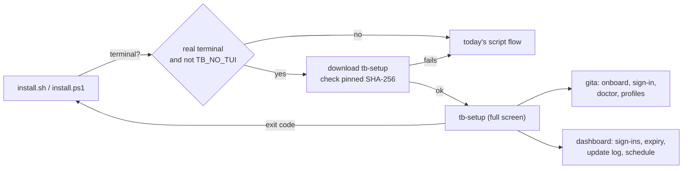

# v0.3.0 - Change Request: Full-screen setup TUI

| | |
|---|---|
| **CR id** | CR-0.3.0-01 |
| **Version** | 0.3.0 (target; Alpha). The repo has no `VERSION` file; 0.2.1 was the last hotfix. |
| **Status** | Approved (2026-11-23) |
| **Owner** | Naseeb Naushad |
| **Branch** | `feature/setup-tui` |
| **Date** | 2026-11-23 |

## 1. Summary
The setup is two long shell scripts. They work, but they print a scrolling log, ask questions one
line at a time, and give no view of what is healthy afterwards. This change adds a **full-screen
terminal app** in the style of btop: it takes over the whole terminal, shows the setup steps and a
live log side by side, a token form with a duration menu, and a **status dashboard** (sign-ins and
when they expire, last and next update, `gita doctor`). It is a small Go program (Bubble Tea) kept
in this repository. The installers download a pinned, SHA-256-checked copy for the OS and use it
whenever there is a real terminal; without one, they run exactly as today.

## 2. Answers to the clarifying questions
| Topic | Answer |
|---|---|
| Goal | A seamless, clear setup and update experience for every ThoughtBox developer, and a place to see at a glance whether this computer is healthy. |
| Users | All developers on macOS (Apple silicon), Windows 10/11 x64 and Linux x64, the same platforms Gita supports. |
| In scope | The `tb-setup` program: full-screen setup run (steps, live log, questions as forms, token + duration form), status dashboard, `--update` run for the scheduler, download/pin/verify in both installers, CI that builds and tests it, docs. Lives in `tui/` of this repository (answered). |
| Out of scope | Code signing and notarisation (answered: unsigned but checksummed). Intel Macs, ARM Linux and Windows on ARM (Gita does not support them either). Replacing Gita, or any change to what the setup installs. A new repository. |
| Edge cases | No terminal (pipe, CI, scheduled task): the scripts run as today. Terminal too small: a "make the window larger" screen. `NO_COLOR` and 16-colour terminals: plain styling. Resize while running. Ctrl+C: stop the running step cleanly and say what is half done. Download or checksum failure: fall back to the scripts, never run an unchecked binary. Windows legacy console without ANSI: fall back. |
| Constraints | Closed-source rules apply (licences section 7). No secret ever on a command line, in the log or on screen. Same pinned-checksum trust model as Gita. Must not make the install command longer or slower for the common path. |
| Definition of done | Fresh-machine setup and an update both complete through the TUI on all three systems in CI (against a fake `gita`) and once by hand with a real account; scripts still work unchanged with no terminal; dashboard shows real data; tests, vulnerability scan and licence check clean; docs and change note written. |

## 3. Impact analysis
| Area / file | How it is affected | Action |
|---|---|---|
| `install.sh`, `install.ps1` | New step before `gita onboard`: if a terminal exists and `TB_NO_TUI` is not set, download the pinned `tb-setup`, verify, run it, and stop. Any failure falls back to the current flow. New pinned version and three checksums. | change + test |
| `scripts/gita-bump.sh`, `.github/workflows/gita-bump.yml` | Pattern for pinning; a second bump job (or a release step) updates the `tb-setup` pins. | change |
| `.github/workflows/test-install.yml` | Add Go build/test jobs and a job that runs the TUI against a fake `gita` on ubuntu, macos and windows. | change |
| New `.github/workflows/release-tui.yml` | Builds the three binaries on a tag, writes `SHA256SUMS`, attaches them to a GitHub release. | new |
| `thoughtbox-onboarding.json` | Read by the TUI to list the steps and accounts. Its pinned checksum stays. | none (read only) |
| `--update` / daily schedule (PR #13) | The scheduled job keeps running the scripts in v0.3.0. The TUI's status view reads the same log and lock. | test |
| Classic token option (PR #12) | The TUI gets the same token form and duration menu; the shell version stays for the no-terminal-fallback. Logic (scopes URL, expiry check) is written once per language and covered by the same test cases. | change + test |
| Gita (`gita onboard`, `sign-in --json`, `doctor --json`, `profiles --json`) | The TUI drives Gita. `gita onboard` has no machine-readable progress today (see open question O1). | depends on O1 |
| `README.md`, `documents/README.md`, `documents/Lifecycle and process flows.md`, `CLAUDE.md` (missing) | Describe the TUI, the fallback and the new pins. | change |
| claude-standards `setup.sh` / `setup.ps1` | Run by Gita as before; the TUI only shows their output. | none |

Suggested related improvements (not in scope unless approved):
- Sign the release binaries and the `install.*` scripts (for example `ssh-keygen -Y sign` with a
  key pinned in the installer) so a compromised `main` cannot reach every machine. Recommended
  before the daily update runs the TUI.
- Add the missing `CLAUDE.md`, `.env.example` and `AI Onboarding.md` to this repository.

## 4. Design
`tb-setup` is a single static Go binary. It never decides what the setup does: the steps come from
the onboarding file and Gita does the work. The TUI shows it and collects the answers.



Screen (alternate screen buffer, restored on exit):

```
┌ ThoughtBox setup ─────────────────────────────────────────────────────────┐
│ Steps               │ Live log                                          │
│ ✔ Gita 1.2.0       │ ==> Your GitHub accounts                          │
│ ✔ Tools            │   Profile for naseeb@thoughtbox.io exists         │
│ ▶ Sign-in AI       │   ThoughtBox AI: signed in as @naseebnaushad93    │
│ · claude-standards │                                                   │
│ · Doctor           │                                                   │
├─────────────────────┴───────────────────────────────────────────────────┤
│ Token expires in 364 days · last update 2h ago · next 11:34 │ q quit  ? help │
└───────────────────────────────────────────────────────────────────────────┘
```

Views: **Setup** (steps + log, modal forms for name/email, the sign-in code, the token form with the
duration menu and the expiry check), **Dashboard** (profiles with sign-in state and token expiry
countdown from GitHub's `github-authentication-token-expiration` header, Gita version, `gita doctor`
result, last and next update, buttons to run an update, renew a sign-in or turn the schedule on or
off), **Help**. Keyboard first (arrows, Tab, Enter, Esc, `q`), mouse optional, redraw on resize.

### Decisions
| # | Decision | Reason | Alternatives considered |
|---|---|---|---|
| D1 | Go with Bubble Tea, Lip Gloss, Bubbles | Mature, MIT, cross-platform full-screen TUIs with resize and mouse; one static binary per OS, no runtime to install | Wails (a GUI window, not a terminal); Python curses (not on Windows); Rust ratatui (smaller team knowledge); bash/PowerShell "TUI" (fragile, not btop-like) |
| D2 | Code in `tui/` of this repo | One PR flow and one review; releases cut by tag | New repo (more to maintain); inside Gita (Dart has no mature TUI library) |
| D3 | The scripts stay as bootstrap and fallback | Works with no terminal, in CI and when the binary can't be fetched | Binary only (breaks piped and scheduled runs) |
| D4 | Pin each binary's SHA-256 in the installers, like Gita | Same trust model; a person reviews each bump | Download "latest" (unpinned, rejected for Gita too) |
| D5 | Unsigned binaries, fetched with curl / Invoke-WebRequest | No Gatekeeper or SmartScreen quarantine for these downloads; no certificate cost (answered) | Apple Developer ID and Windows certificate (cost, lead time) |
| D6 | The TUI drives Gita through its documented commands and never touches the key store itself | One place for sign-in logic; tokens never pass through the TUI's logs | Re-implementing sign-in in Go |
| D7 | v0.3.0 = Setup + status dashboard; the scheduled update keeps running the scripts | Smaller step; the update runner can move later (answered: scope) | TUI as update runner now (largest change) |
| D8 | Tokens: stdin to `gita sign-in --with-token` only; masked input; never in env, args, log or screen | Company rule 8 | Passing via env (visible to other processes) |

## 5. Feature parity
The TUI is additive, but it replaces the interactive path of the scripts, so it must do everything that path does.

| # | Existing behaviour | New location | Test | Status |
|---|---|---|---|---|
| P1 | Download and verify the pinned Gita; upgrade older, keep newer, reinstall broken | Scripts (unchanged, run before the TUI) | existing CI | ☐ |
| P2 | Name and email questions, `TB_NAME`, `TB_EMAIL_*` | TUI form; env vars still honoured | TUI tests | ☐ |
| P3 | Old GitHub sign-in clean-up (ask / `TB_CLEAN`) | TUI question; `--clean` passed to Gita | TUI tests | ☐ |
| P4 | Browser sign-in code | TUI modal showing the code and URL | fake gita | ☐ |
| P5 | Classic token with duration menu, expiry check | TUI form (same rules as PR #12) | TUI + pty tests | ☐ |
| P6 | Optional Figma bridge (`TB_FIGMA`) | TUI question; script logic reused | existing CI | ☐ |
| P7 | Dry run (`TB_DRY_RUN`), log file, exit codes, summary | TUI honours the same; log file written | TUI tests | ☐ |
| P8 | No-terminal runs | Scripts, unchanged | existing CI | ☐ |

## 6. Security checklist
- [ ] Input validated and length-limited (name, email, token) at the form boundary
- [ ] No HTML/eval; terminal control characters stripped from anything displayed (log lines, names)
- [ ] No server component; nothing authenticates to us
- [ ] Secrets never logged or committed; tokens only via stdin to Gita; masked on screen
- [ ] Errors generic on screen; details in the log, without tokens or personal data
- [ ] TLS 1.2+ and timeouts on every network call; checksum checked before the binary is ever run
- [ ] New dependencies: licences allowed (section 7), maintained; pinned in `go.sum`
- [ ] `govulncheck` clean in CI; release binaries built from a tag in CI, not on a laptop

## 7. Dependencies
| Package | Version | Licence | Why needed |
|---|---|---|---|
| github.com/charmbracelet/bubbletea | v1.3.10 | MIT | TUI runtime (alternate screen, resize, mouse) |
| github.com/charmbracelet/lipgloss | v1.1.0 | MIT | Layout and styling |
| github.com/charmbracelet/bubbles | v1.0.0 | MIT | Lists, viewport, text input |
| golang.org/x/term | v0.48.0 | BSD-3-Clause | Terminal detection and masked input |

Versions are the latest found on 2026-11-23; licences are to be confirmed by the licence scan when the module is created, and the transitive set re-checked then.

## 8. Test approach
Details go in "v0.3.0 - Alpha Test Cases". Go unit tests for the model and the form validation;
`teatest`-style tests that drive the model with key events and compare screens; pseudo-terminal
tests of the real binary against a fake `gita` on all three systems in CI; script tests that the
fallback is used with no terminal, a bad checksum and `TB_NO_TUI=1`; golden screens for a small
terminal, `NO_COLOR` and resize; one manual run on a fresh machine for each OS with a real account.

## 9. Open questions
- **O1.** `gita onboard` prints text and asks its own questions on the terminal. The TUI needs
  machine-readable progress and a way to answer questions itself. Preferred: a small Gita change
  (`gita onboard --events`, JSON lines on stdout, answers via flags), released as Gita 1.3.0, with the
  TUI refusing to run against an older Gita (it falls back to the scripts). Alternative: run
  `gita onboard` inside a pseudo-terminal in the log pane (more fragile, awkward on Windows).
- **O2.** Who may publish `tb-setup` releases, and do we add the artifact signing named in section 3 before the daily update can run the TUI?
- **O3.** Minimum terminal size (proposed 80 x 24) and how the dashboard refreshes (proposed every 60 s, no network calls except the token expiry check, once per start).
- **O4.** Should `tb-setup status` also exist as a non-interactive command (print one screen and exit) for scripts and support?

## 10. Change history
| Date | Version | Change |
|---|---|---|
| 2026-11-23 | 0.3.0-alpha.1 | CR created |
| 2026-11-23 | 0.3.0-alpha.1 | Approved as written by the owner |
